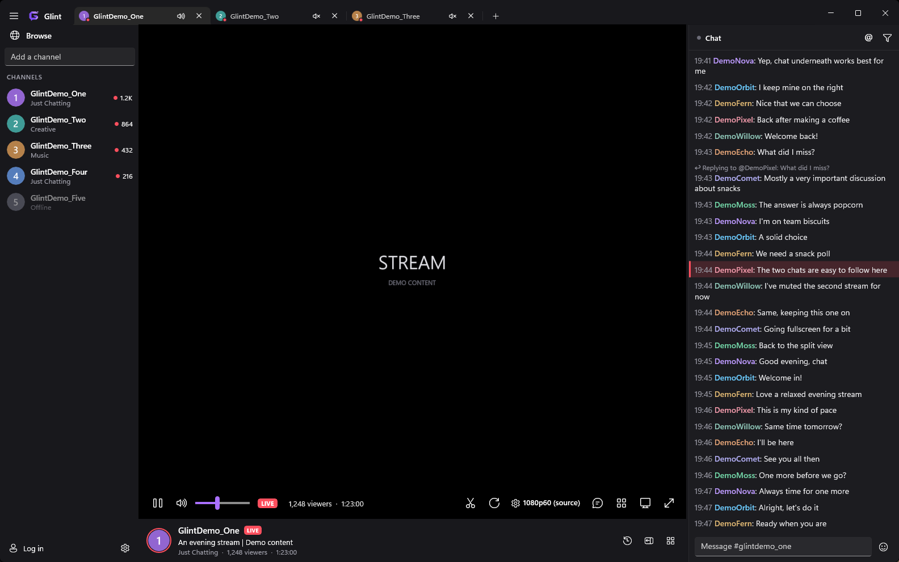
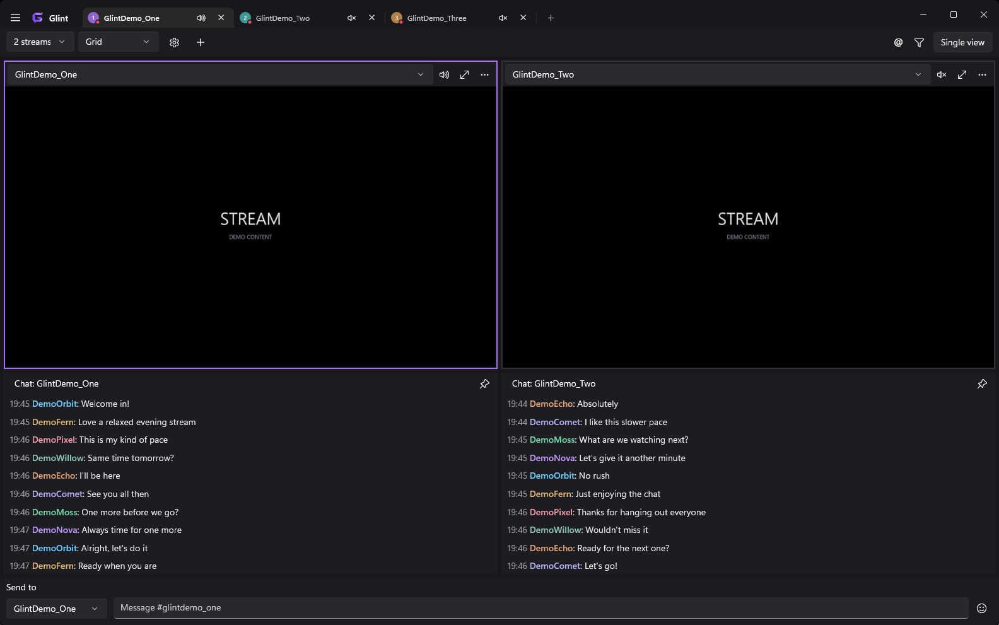

<p align="center">
  
</p>

Glint is a native Twitch client for Windows, bringing streams and chat into a customisable desktop app.

## Download

Download the [latest Windows x64 release](https://github.com/althedrunk/Glint/releases/latest).

- **Installer:** run the `Setup.exe` download for a Start menu shortcut and normal Windows uninstall support.
- **Portable:** extract the `Portable.zip` download into a writable folder and open `Glint.exe`. Keep the `Data` folder beside it; this holds your settings and downloaded player.

No development tools or administrator access are needed. The first time you play a stream, Glint offers to download its video component directly from mpv's official release. This is a one-time setup.

Requires 64-bit Windows 10 version 2004 or later, or Windows 11. Tested on Windows 11. Twitch sign-in also requires the [Microsoft Edge WebView2 Runtime](https://developer.microsoft.com/microsoft-edge/webview2/). Glint is unsigned, so Windows may display an unknown-publisher warning.

## Overview

- Watch live streams and past broadcasts with hardware-accelerated playback, theatre and fullscreen modes.
- Keep channels open in tabs or watch up to four streams in multiview, with flexible chat layouts and independent audio controls.
- Home page with your live followed channels and recently watched ones.
- Reopen live tabs, all tabs, or start on the home page at launch.
- Built-in updates from GitHub releases, with release notes, for installed and portable copies.
- Browse channels and categories, and create clips from the player.
- Chat with Twitch, 7TV, BTTV and FFZ emotes, replies, mentions and searchable message history.
- Customise the appearance, chat, notifications and shortcuts, with saved profiles and layouts.

Watching and reading chat work without an account. Sign in with Twitch for sending messages, followed channels, your emotes and supported subscriber and Turbo benefits.

## Demo screenshots

Screenshots use fictional channels and messages with placeholder video.





## Install from source

Requires 64-bit Windows 10 version 2004 or later, or Windows 11, and the [.NET 10 SDK](https://dotnet.microsoft.com/download). Glint has been tested on Windows 11.

From a checkout of this repository, run:

```powershell
powershell -ExecutionPolicy Bypass -File tools\fetch-mpv.ps1
powershell -ExecutionPolicy Bypass -File tools\install.ps1
```

This installs Glint to `%LOCALAPPDATA%\Programs\Glint` and creates Start menu and desktop shortcuts. Run `tools\install.ps1` again to update it after pulling changes.

For a development build:

```powershell
dotnet build src\Glint -c Debug
```

To build the installer and portable ZIP, install [Inno Setup 7](https://jrsoftware.org/isinfo.php), then run:

```powershell
powershell -ExecutionPolicy Bypass -File tools\package-release.ps1 -InnoCompiler "C:\path\to\ISCC.exe"
```

Both downloads and their checksums are written to `dist\releases`. The script also accepts `INNO_SETUP_COMPILER` or finds a standard Inno Setup 7 installation. Runtime files are bundled inside `Glint.exe`; licence material is kept in `Docs`.

The video library is downloaded separately by `fetch-mpv.ps1` from [shinchiro's mpv builds](https://github.com/shinchiro/mpv-winbuild-cmake).

<details>
<summary>Keyboard shortcuts</summary>

These are the default bindings. Most can be changed in Settings under Shortcuts. Seek distances can be changed under Player.

| Key | Action |
|---|---|
| F or F11 | Toggle fullscreen |
| Double-click a video | Toggle fullscreen in single view; enlarge or restore a multiview tile |
| T | Toggle theatre mode; leave fullscreen for theatre |
| C | Show or hide chat |
| Esc | Restore an enlarged tile, close the broadcasts panel, or leave fullscreen or theatre |
| M | Mute or unmute the selected tab |
| ↑ / ↓ or mouse wheel over the volume control | Adjust volume |
| Space | Pause or resume the selected video |
| ← / → or J / L | Seek back or forward 10 seconds in a past broadcast |
| Shift+← / Shift+→ | Seek back or forward a minute in a past broadcast |
| 0–9 | Jump to 0–90% of a past broadcast |
| Alt+X | Clip the live stream (needs a login) |
| Ctrl+H | Home |
| Ctrl+B | Open or close Browse |
| Ctrl+Shift+M | Enter or leave multiview |
| Ctrl+T | Open an empty tab |
| Ctrl+L | Enter a channel in the current tab |
| Ctrl+W | Close the selected tab |
| Ctrl+Tab / Ctrl+Shift+Tab | Next or previous tab |
| F5 | Reload the selected stream |
| Ctrl+F1 | Open Settings |
| Tab in the message box | Complete an emote or @name |
| : + two or more characters | Find emotes; arrows select, Tab or Enter inserts, Esc closes |
| Esc in the message box | Cancel a reply |

Single-letter shortcuts are inactive while typing or using an input control.

</details>

## Notes

Glint uses Twitch's unofficial web API for channel information and playback. Changes to that API can affect compatibility. Clip creation requires the separate API login in Settings.

The installed edition stores settings in `%APPDATA%\Glint\settings.json` and downloads in `%LOCALAPPDATA%\Glint`. The portable edition stores these in its adjacent `Data` folder. Keep that folder when updating or moving a portable copy. Login tokens are encrypted for the current Windows account; sign in again after moving to another PC. Uninstalling the installed edition preserves your settings and downloaded player.

Glint is built with WinUI 3, [mpv](https://mpv.io) and Win2D. Thanks to [7TV](https://7tv.app), [BTTV](https://betterttv.com) and [FFZ](https://frankerfacez.com) for their emote services, and [Chatterino](https://chatterino.com) for inspiration.

Glint is independent of Twitch and is not affiliated with or endorsed by it.

## Licence

Glint is [MIT licensed](LICENSE). Other components retain their own licences; see [third-party notices](THIRD-PARTY-NOTICES.md). The Windows download gets libmpv separately from its publisher during video setup.
